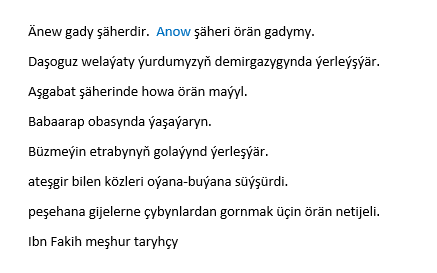

# Turkmen Name Checker (MVP)

A local web application for checking Turkmen research documents against an Excel-based name dictionary. It stores canonical names, categories, and known spelling variants in SQLite, then scans Word `.docx` files and returns a marked copy.

## Features

- Import a dictionary from an `.xlsx` workbook.
- Mark known spelling variants in **red**.
- Use a character n-gram TF-IDF model with edit-similarity ranking to suggest likely, unlisted variants in **blue**.
- Optionally replace red, dictionary-listed variants with their canonical spelling by selecting **“Awtomatiki düzetmelimi?”** before scanning. Blue suggestions are never automatically changed.
- Reset the dictionary from the home page and start learning from newly uploaded Excel data.
- Keep the database and processed documents on the local machine.

## Excel dictionary format


The application reads columns A–C from the first worksheet. A header row is optional. If present, use `Canonical` or `Standart ad` as the first-column header.

| Column | Value | Example |
|---|---|---|
| A | Canonical/standard name | Änew |
| B | Category or label | Person name |
| C | Known incorrect spellings, separated by commas, semicolons, `|`, or line breaks | `[Anou, Anau, Anow]` |

Each variant is stored separately. Re-uploading existing rows does not duplicate them; new rows are added to the existing dictionary. The reset button clears the dictionary so it can be rebuilt from newly uploaded data.

## Run from source

Requirements: Windows, Python 3.10 or newer, and an internet connection to install dependencies.

```powershell
py -m venv .venv
.venv\Scripts\Activate.ps1
pip install -r requirements.txt
uvicorn app:app --reload
```

Open `http://127.0.0.1:8000`, upload the Excel dictionary, then upload a `.docx` file. The application returns a download link for the processed document.

In source mode, SQLite data is stored in `data/names.sqlite3` and processed documents in `data/processed/`. Set `TXT_ANALYZER_DATA_DIR` before startup to use a different local data directory.

## Build the Windows executable

Create a virtual environment named `venv`, then run the build script from PowerShell in the project directory:

```powershell
py -m venv venv
venv\Scripts\Activate.ps1
.\build_exe.ps1
```

The single-file executable is written to `dist\TurkmenAdDenetleyici.exe`. It starts the local web server and opens the default browser. Keep the console window open while using the app; close it to stop the server. The executable does not require Python to be installed on the target computer.

In executable mode, the database and processed documents are stored under `%LOCALAPPDATA%\TurkmenAdDenetleyici`. Upload the Excel dictionary after the first launch to populate that database.


## Matching and correction behavior

- Red matches are exact matches against variants listed in column C, ignoring letter case and respecting word boundaries.
- Blue suggestions are generated for single words of at least four characters. The model is refitted from the current SQLite dictionary for each document scan.
- The displayed similarity score is not a calibrated probability. Review blue suggestions before using them.
- With automatic correction enabled, only red matches are replaced with the canonical name from column A. Blue suggestions stay unchanged.
- The scanner checks document paragraphs, tables, headers, and footers. It accepts `.docx`; convert legacy `.doc` files to `.docx` before uploading.
- Commas separate variants in column C, so a name containing a comma is not supported by that delimiter.


---



## Build files

- `app.py` — FastAPI application and document processing
- `launcher.py` — starts the server and opens the browser
- `requirements.txt` — application dependencies
- `requirements-build.txt` — application and PyInstaller dependencies
- `build_exe.ps1` — Windows executable build script
